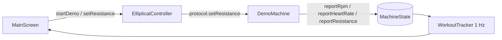

# Design Document — Demo mode

## Overview

Demo mode adds a `DemoMachine` that plays the role of a `MachineProtocol` without a
`GattLink`. The Controller already funnels every user action (set resistance, workout
commands) through `protocol`, and the Workout tracker only reads `MachineState`. Injecting a
fake protocol therefore exercises the real pipeline with no changes to the tracker.

## Architecture

## Components and Interfaces

### DemoMachine (`protocol/DemoMachine.kt`)

- Extends `MachineProtocol` so it reuses `reportRpm`, `reportHeartRate`, `reportResistance`,
  `applyRange` and `reportMachineType` — the same helpers real protocols use.
- `start()`: sets range 1–24, machine type 11, `controlReady = true`, schedules a 1 s tick.
- Tick: if pedalling, `rpm = base(resistance) + 6·sin(t/9)` with
  `base = 68 − 0.9·(resistance − 1)` clamped to 40..75; heart rate moves toward a
  target `85 + 2.4·resistance + 0.5·(rpm − 50)` clamped to 80..170 by at most 2 bpm/s.
- `setResistance(level)`: posts `reportResistance(level)` after 300 ms.
- `pedalling` flag toggled by the UI; when false, reports `rpm = 0`.
- `release()`: cancels the tick.

`onNotify()` is a no-op. `MachineProtocol` takes a `ProtocolHost`; the host's `link` is never
touched by `DemoMachine`.

### Controller changes

- `startDemo()`: stop scan, release any protocol, disconnect a real link, reset
  `MachineState` with `phase = READY`, `protocol = ProtocolKind.DEMO`, then create and start
  `DemoMachine`.
- `disconnect()` and `connect()` release the demo machine first.
- `demoPedalling` property forwards to the machine.

### UI changes

- Connect card: "Demo mode (no machine needed)" button, does not call `withBluetooth`.
- Status card: protocol label shows "Demo — simulated elliptical"; a pedalling switch is shown
  in the workout card when the protocol is DEMO.

## Data Models

`ProtocolKind.DEMO` is added. `ProtocolChoice` does not get a DEMO entry (it only applies to
BLE connections), and `ProtocolDetector.create` rejects DEMO.

## Error Handling

Demo mode cannot fail; it never touches Bluetooth. If the app is backgrounded the Handler
tick keeps running in-process, like the HuanTong heartbeat.

## Testing Strategy

Manual: start demo, observe auto-start within 1–2 s, change resistance and see the echo and
the cadence drop, toggle pedalling off and observe auto-pause after the configured seconds,
finish and confirm a history entry. Calorie sanity: at level 10 / ~60 rpm the burn rate
should read about 8 kcal/min with the default algorithm.
