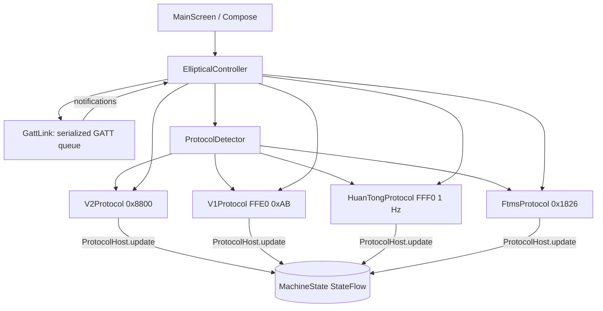

# Design Document — Mobi resistance control

## Overview

Single-activity Compose app. An app-scoped `EllipticalController` owns scanning, the GATT
link, protocol selection and reconnects. Each control-box family is a `MachineProtocol`
subclass. Full byte-level notes: `docs/PROTOCOL.md` (zh) / `docs/PROTOCOL.en.md` (en).

## Architecture

## Components and Interfaces

- `ble/GattLink`: `connect`, `read`, `write`, `enableNotify` (notify or indicate),
  `requestMtu`; FIFO queue, 3 s per-op timeout, API 33+ and legacy callbacks. Write type is
  the stack default for the characteristic (same as FastBle in the official app).
- `protocol/MachineProtocol`: `start()`, `onNotify()`, `setResistance()`, `sendWorkout()`,
  `release()` plus shared helpers (`applyRange`, `reportRpm`, `reportResistance`, standard
  heart-rate/battery/device-info handling).
- `protocol/ResistanceTables`: official per-model resistance mode / max tables.
- `EllipticalController`: debounced resistance, reconnect policy, raw-write debug helper.

## Data Models

`MachineState` (phase, protocol, range and source, target and reported level, cadence,
heart rate, machine totals, …), `AppSettings` (SharedPreferences).

## Error Handling

Failed/timeout GATT ops are logged and the queue continues. 2.0 unlock failure still sends
the command and retries unlock next time. Unknown protocol → disconnect with message.
GATT 133 / drops → bounded reconnect.

## Testing Strategy

Byte formats are checked against the decompiled sources (paths in `docs/PROTOCOL.md`).
Real-machine verification is done with the in-app log. Demo mode (separate spec) covers
UI and workout flow without hardware.
